# Tracktos

A friendly window into Aptos: an explorer for wallets and the network, built to make the chain easy to see and understand.

**[Open it → tracktos.com](https://tracktos.com)** · free, no sign-up, works on phones and desktop

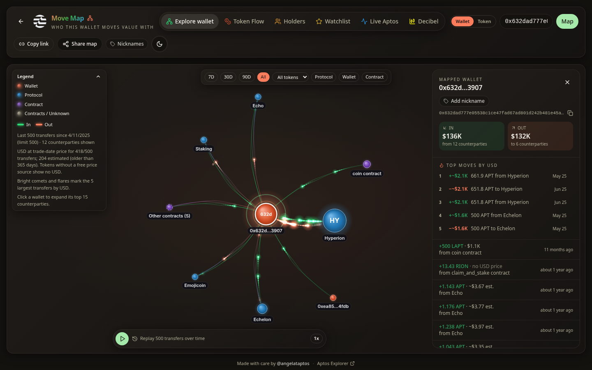

## Why it exists

I'm a community manager at the Aptos Foundation, in crypto since 2021. Every day people ask me simple questions: what is this wallet doing, where is this token going, how busy is the network? Block explorers answer them, but not in a way most people can *see*. Tracktos draws the answers: who a wallet moves value with, where a token is flowing right now, and what mainnet looks and sounds like block by block. Building it was also how I learned how Aptos works under the hood.

## Who uses it

Aptos community members, holders and curious newcomers who want a visual, phone-friendly way to explore wallets and the network.

## The numbers

*As of October 16, 2026:* Tracktos launched on **October 14, 2026**, so it's early days and I'm not publishing usage numbers yet (my own testing would inflate them, so it's now excluded from the counter). It covers **mainnet and testnet**, with six main views: Move Map, Token Flow, Holders, Pulse, Network and the Wallet explorer, plus **168 address labels** from the official Aptos Explorer's public list and **8 more** verified on-chain.

## What you can do

### Explore a wallet: Move Map
Paste any Aptos address and its counterparties appear as living streams of value: bubbles sized by volume, flowing in and out of the wallet. Play back its history over time, spot the biggest moves as flares, expand two hops out, filter by token, period and kind (wallets, protocols, contracts), and share a card of the map. Known exchanges and protocols are labelled.

### Token Flow
Pick APT, USDC, USDt or any coin type / fungible asset and see its recent transfers as one picture: who is sending, who is receiving, and which exchanges and protocols sit in the middle, over the last hour, day or week.

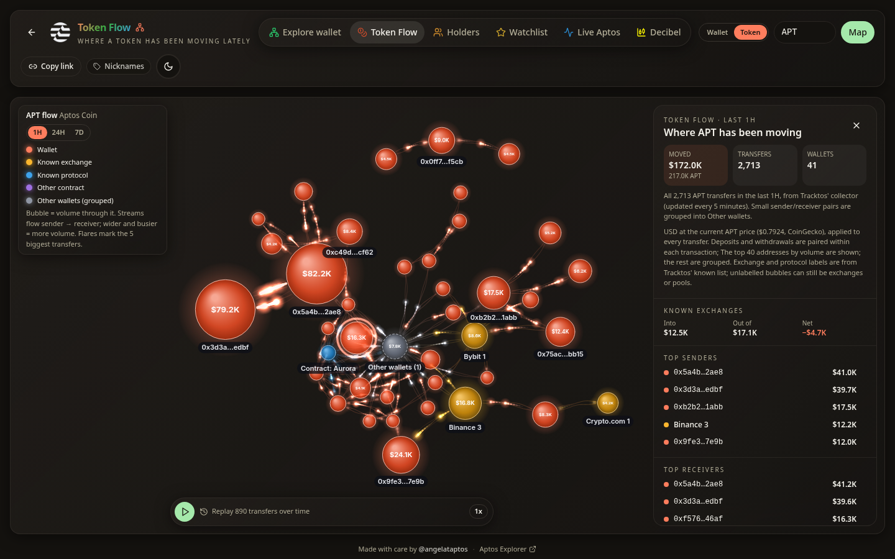

### Holders
The 100 largest holders of APT, USDC, USDt and other major Aptos tokens, with exchanges and protocols labelled. A distribution panel shows how concentrated a token is: top 10/50/100 share of supply, the concentration index (HHI), how many holders together pass half of supply, and a simple 0–100 score with a plain explanation of how it's calculated. It describes concentration only; it never labels a token as risky or a scam.

### Today on Aptos
The home page opens with the last 24 hours: the biggest single APT, USDC and USDt moves (linked to the explorer, with exchanges named), and how many blocks and transactions the network produced.

### Live Aptos
- **Pulse**: mainnet's live transactions turned into light and sound. Several visual modes (Garden, Constellation, Orbit, Rain, Pulse Lines), each with its own in-key instrument palette that follows network activity, big APT and stablecoin moves called out as they happen, a Live Transactions feed linking to the explorer, ambient mode, and **Record 10s** to save a clip with sound.
- **Network**: a 3D globe of the validator set. Every pulse is a real block, drawn from the validator that proposed it, alongside live TPS, epoch progress, transaction mix, staking and supply.

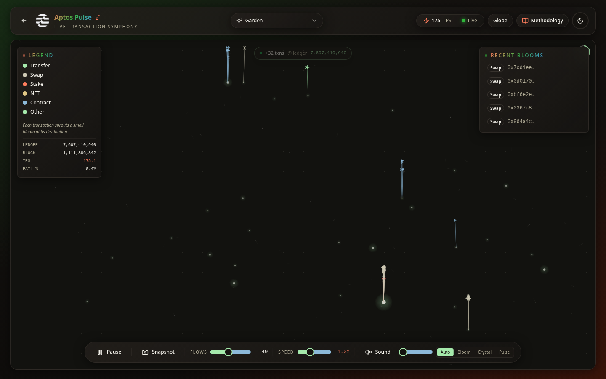
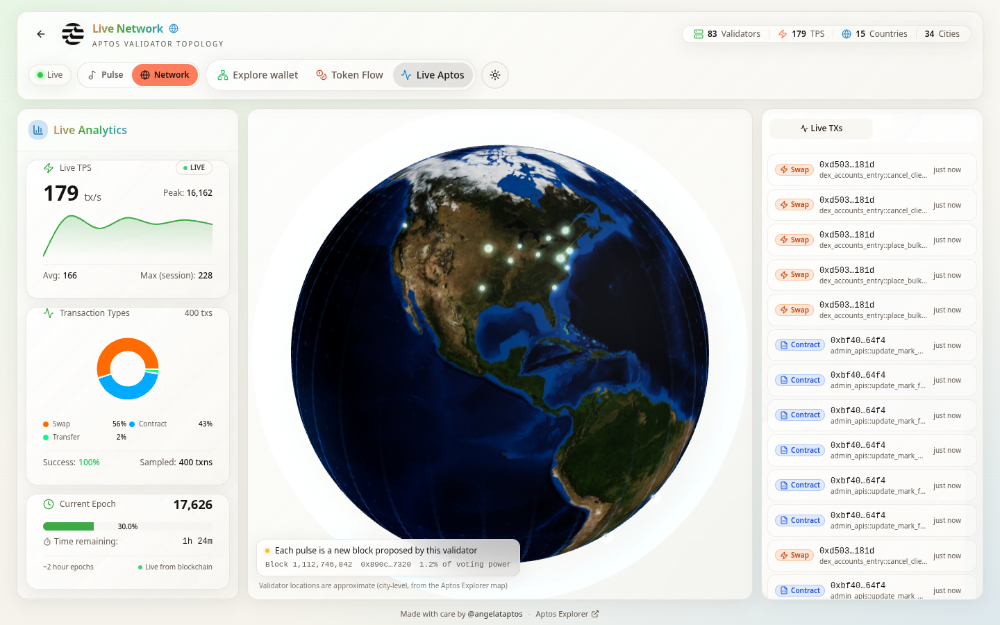

### Wallet explorer
Balances and staking, portfolio history, token holdings, NFT gallery, transaction analytics, DeFi activity and a playful on-chain identity, with export to image or PDF. Mainnet and testnet.

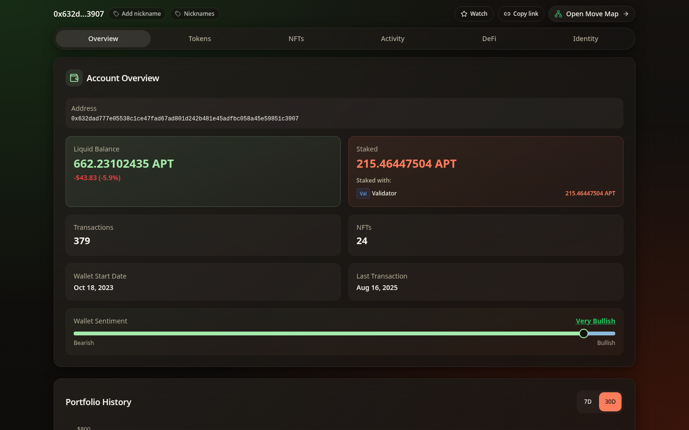

### And
- **Share links**: every Move Map, Token Flow, Holders and wallet view has a Copy link button that reopens exactly what you were looking at, and links shared on X show a matching title and description
- **Busy wallets** like exchanges get a quick summary instead of a map that would take too long to draw
- **Nicknames** for wallets you follow, saved only in your browser
- **Light and dark** themes
- Designed for **phones** as carefully as for desktop

| | | |
|---|---|---|
| 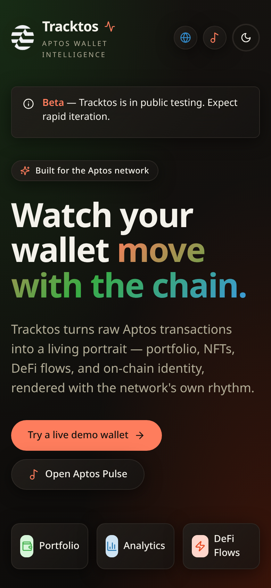 | 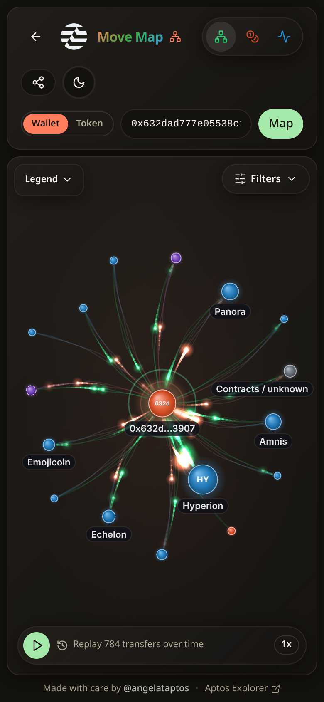 | 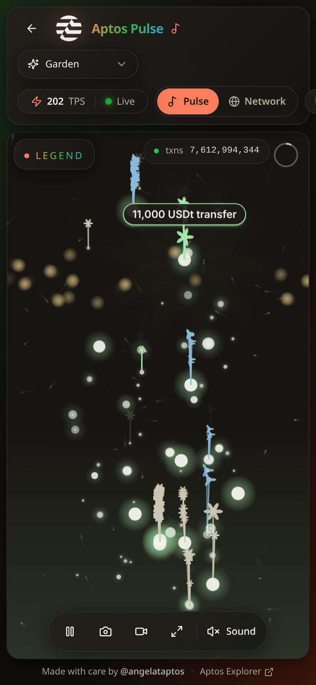 |
| 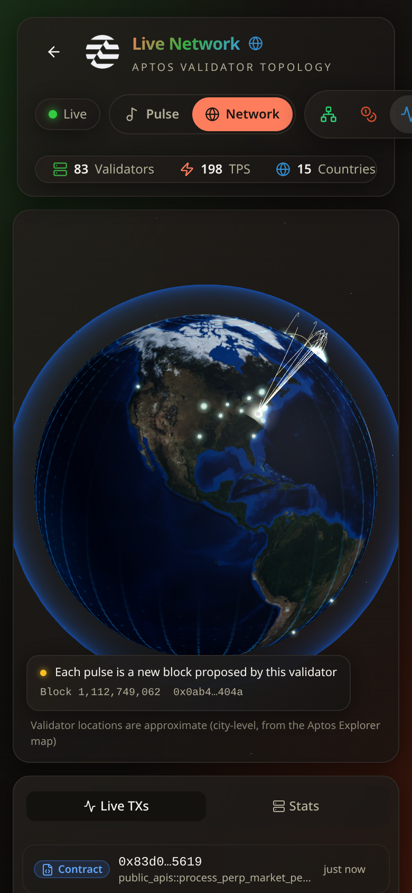 | 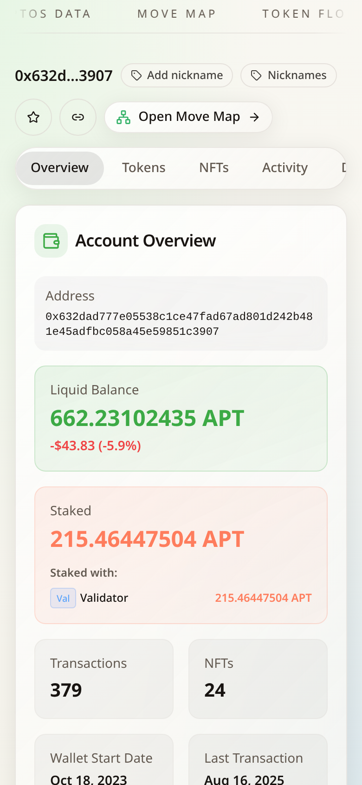 | 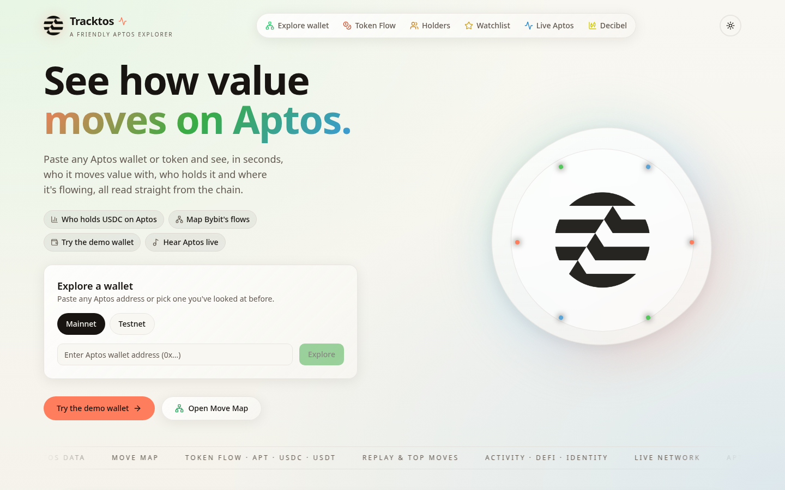 |

## How I built it

A web app on Cloudflare Pages, with small Cloudflare Workers that read Aptos's public APIs once, cache the answer and share it with every visitor, so live pages stay fast and well inside Aptos rate limits. A scheduled collector rolls recent token transfers into a Cloudflare D1 database for Token Flow.

## Challenges I solved

- **Accuracy.** Network and staking stats are checked against official Aptos sources, and token prices are matched by each asset's on-chain address rather than by name or symbol, so look-alike tokens can't be mispriced.
- **Privacy.** Usage is measured with a privacy-first, cookieless counter. Nicknames you give wallets stay in your browser.
- **Security.** I hardened the site before launch, following web security basics.
- **Showing "Unavailable" instead of a wrong number.** Every new figure (holder shares, concentration, the day's biggest moves, block counts) was cross-checked against the chain itself before launch, and where a number can't be stated reliably the site says so. For example, the inequality measure (Gini) isn't shown because 100 holders aren't enough to compute it honestly.
- **Very busy wallets.** Exchange wallets have millions of transfers; rather than hang, Tracktos recognises them and shows a fast summary.
- **Speed on live data.** Shared edge caching keeps the live views smooth for everyone at once.

## What I learned

- **Shipping on Cloudflare**: Pages, Workers, scheduled jobs and D1 working together.
- **Building in public** with the X community, sharing previews and launch posts.
- **Iterating from feedback**: refining views and labels based on what people found confusing.
- **Data accuracy**: verifying every number against official sources before showing it.
- **Honest metrics**: knowing the limits of a number (a top-100 view is a lower bound) and saying so on the page.
- **Privacy and security basics**: collect less, store it in the browser where possible, and harden what's public.

## About

Tracktos is a personal project I built for learning and growth, made with care by [@angelataptos](https://x.com/angelataptos). It is not affiliated with Aptos Labs or the Aptos Foundation. For the authoritative view of the chain, use the [official Aptos Explorer](https://explorer.aptoslabs.com/).

The source code is private. See [LICENSE](LICENSE): all rights reserved.
