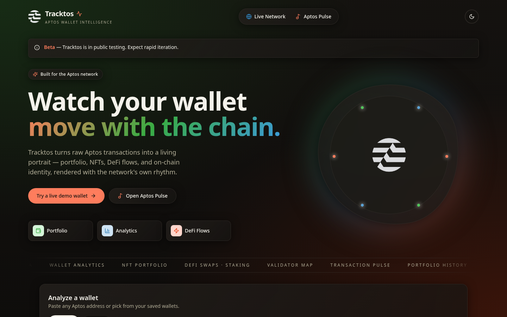
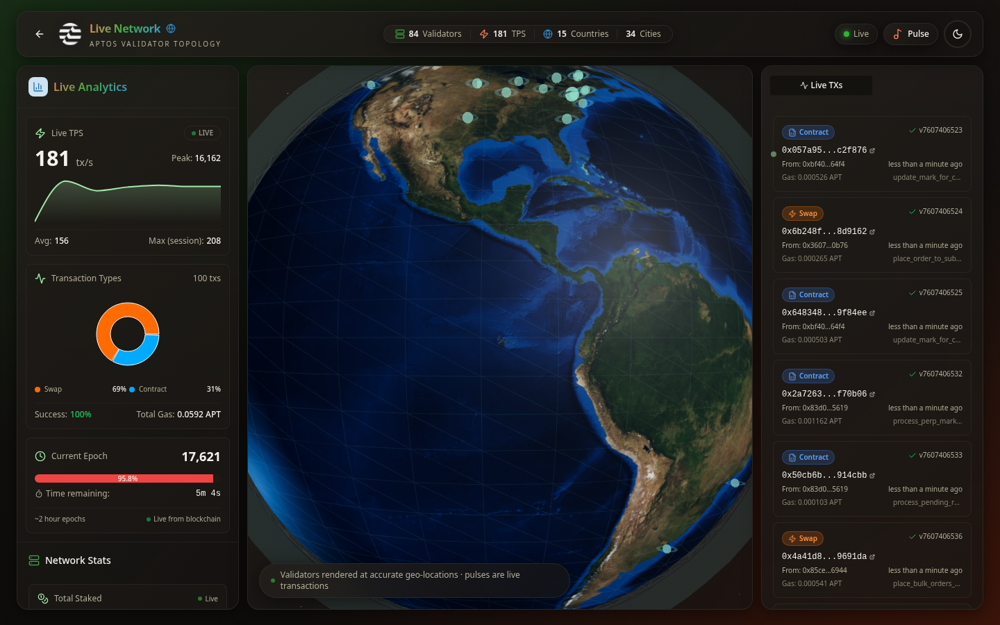
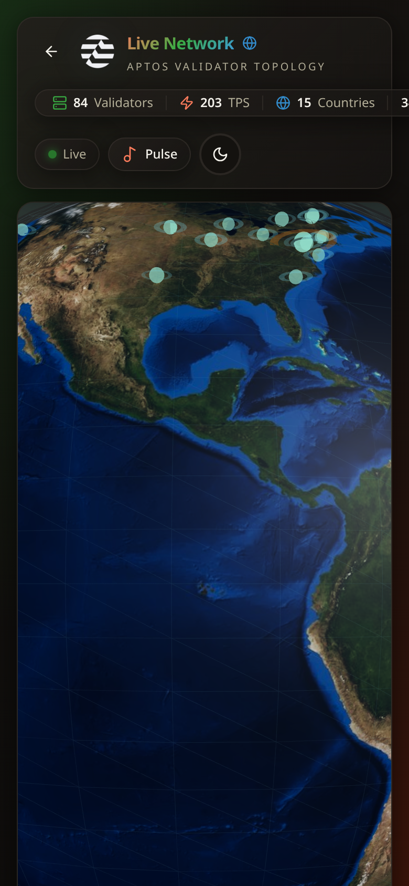

# Tracktos

Aptos wallet intelligence. Paste any Aptos address and Tracktos turns its raw transactions into a living portrait: portfolio, NFTs, DeFi flows and on-chain identity. Then watch the whole network move in real time.

**[Open it in your browser → tracktos.com](https://tracktos.com)** · free, no sign-up, installable on your phone

> Tracktos is in public beta. Expect rapid iteration.

## Features

- **Wallet overview**: liquid and staked APT, total USD value, 24h change, transaction count, first and latest activity
- **Portfolio history** chart by day, week, month or year
- **Token holdings** with balances, prices and USD value for APT and fungible assets
- **NFT gallery** with collection details, purchase prices and a premium NFTs showcase
- **Transaction analytics**: activity heatmap, transaction types, gas spending and top contracts
- **DeFi activity**: swaps, staking, volume per protocol
- **Wallet identity**: active days, wallet age, achievement badges and rankings
- **Shareable cards**: export your wallet stats as an image
- **Saved wallets** with quick switching, plus mainnet and testnet support
- **Light and dark themes**

## Live Network (`/globe`)

A 3D globe of the Aptos validator set at its real geographic locations, with pulses for live transactions. Alongside it: live TPS, transaction type breakdown, epoch progress, a live transaction feed and network stats such as staking, supply, block height and total transactions.

## Aptos Pulse (`/pulse`)

A live transaction symphony. Every visual and every sound is tied to one real mainnet transaction. Choose a mode (Constellation, Garden, Orbit, Pulse Lines or Rain), adjust flows and speed, turn on sound and take snapshots. A methodology panel explains exactly how each transaction is mapped.

## Install (`/install`)

Tracktos is a progressive web app. Add it to your home screen on iPhone, iPad or Android, launch it like a native app and keep using cached data offline.

## On mobile

| Home | Live Network | Aptos Pulse |
| --- | --- | --- |
|  |  |  |

## Architecture

- **Front end**: a React single-page app built with Vite and TypeScript, with 3D graphics for the globe and canvas plus Web Audio for Pulse
- **Hosting**: static assets served from Cloudflare Pages, installable as a PWA
- **Backend**: serverless functions that gather and aggregate wallet and market data
- **Data**: the Aptos blockchain, read through its public fullnode and indexer APIs

## Credits

Built by [@angelataptos](https://x.com/angelataptos)

## License

Copyright (c) 2026 Angel Fundora. All rights reserved. Source code is private.
See [LICENSE](LICENSE).
