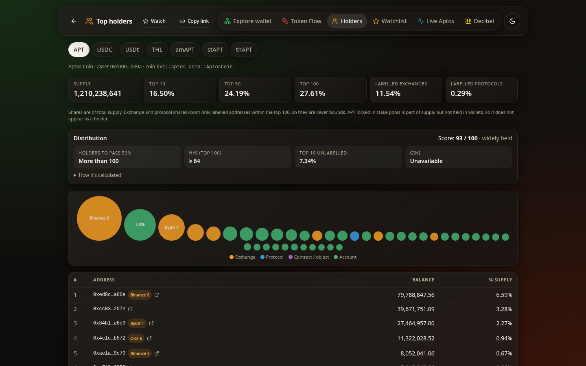
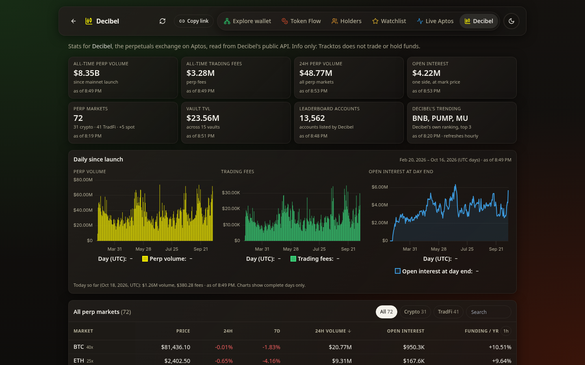
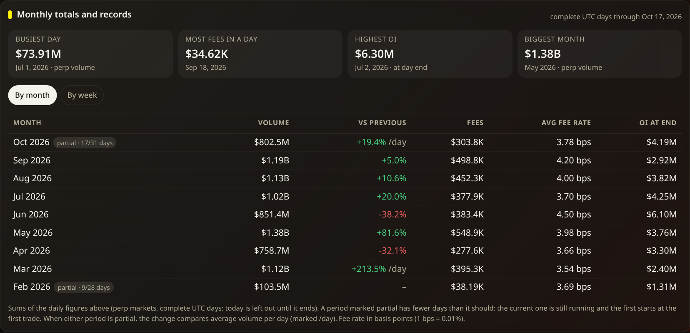
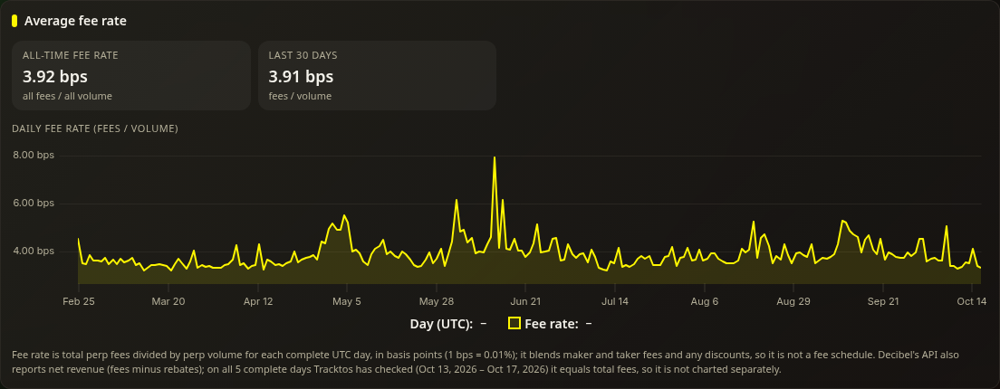
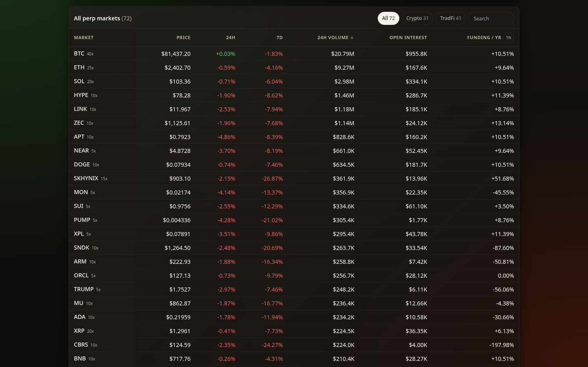
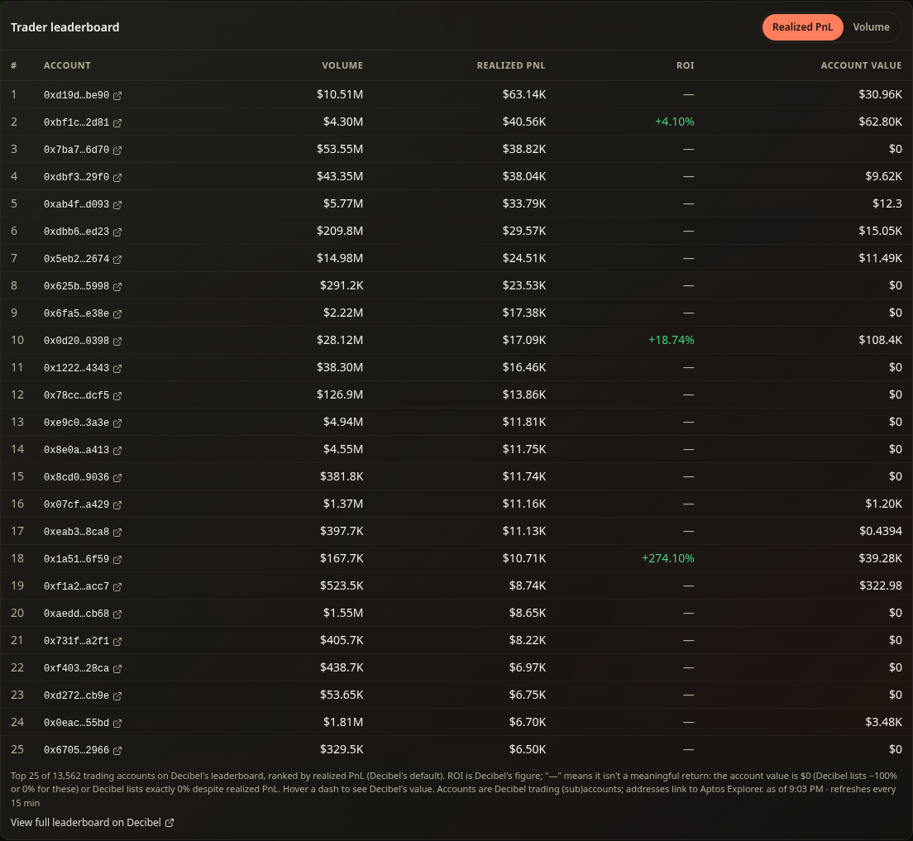
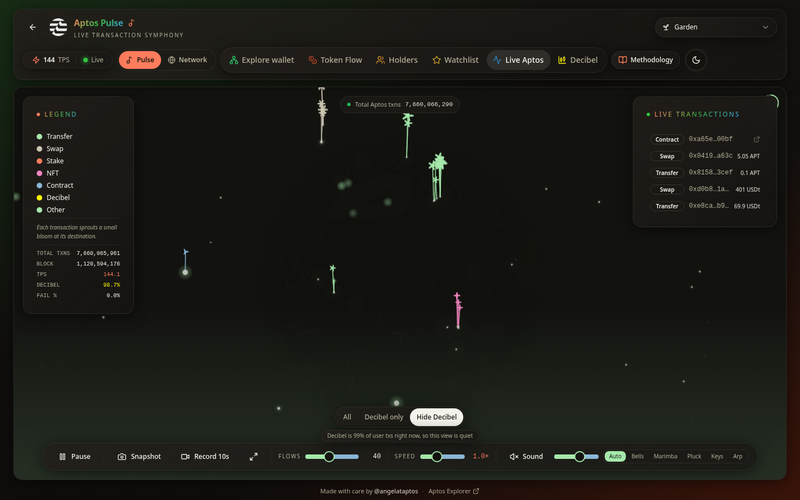
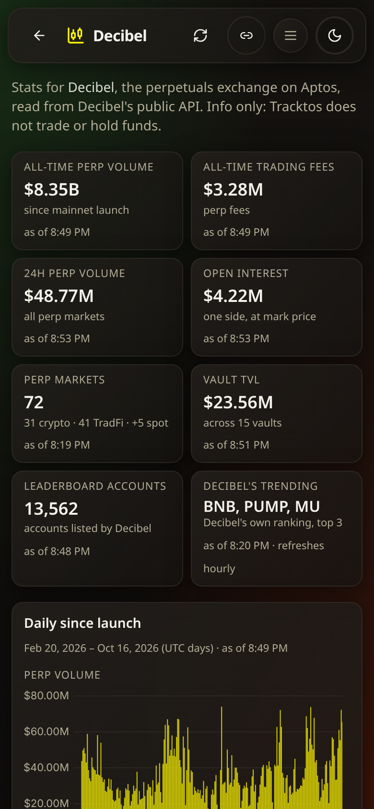
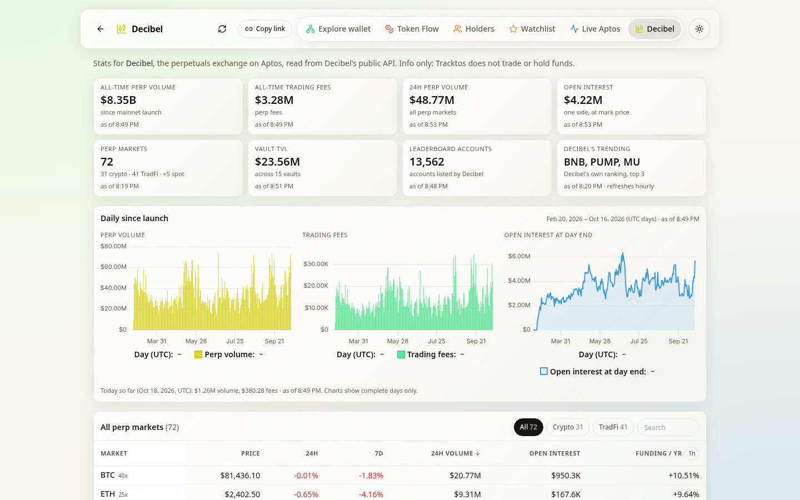

# Tracktos

A friendly window into Aptos: see wallets, tokens, the live network and the Decibel exchange as pictures instead of tables.

**[Open it → tracktos.com](https://tracktos.com)** · free, no sign-up, no wallet connect, works on phones and desktop

## Why it exists

People new to Aptos keep asking the same simple questions: what is this wallet doing, where is this token going, how busy is the network right now? Block explorers have the answers, but as long lists of transactions that most people can't *see*. Tracktos draws them: who a wallet moves value with, where a token is flowing, who holds it, and what mainnet looks and sounds like block by block. Building it was also how I learned how Aptos works.

## Who uses it

Aptos community members, holders and curious newcomers who want a visual, phone-friendly way to explore wallets and the network, and people who follow Decibel and want its stats on one page.

## The numbers

*As of October 17, 2026:* I first built Tracktos a year ago as a simple Aptos portfolio site and relaunched it as a full Aptos explorer on **October 14, 2026**, so it's early days. Three days is too soon to say anything honest about usage, so I'm not publishing usage numbers yet. The relaunch post on X had **100,005** impressions (as of October 17, 2026).

- **Eight views**: Move Map, Token Flow, Holders, Watchlist, Pulse, Network, the Wallet explorer and Decibel, on **mainnet and testnet** (Decibel is mainnet only)
- **176** exchanges, protocols and contracts labelled by name
- **72** Decibel perp markets tracked, matching the markets Decibel itself lists
- In a sample on Oct 17, 2026 (about 23 minutes of mainnet), roughly **99%** of user transactions on Aptos were Decibel activity, which is why Pulse now lets you filter it

## What you can do

### Explore a wallet: Move Map
Paste any Aptos address and its counterparties appear as living streams of value: bubbles sized by volume, flowing in and out of the wallet. Play back its history, spot the biggest moves as flares, expand two hops out, filter by token, period and kind (wallets, protocols, contracts), and share a card of the map.

### Token Flow
Pick APT, USDC, USDt or any coin / fungible asset and see its recent transfers as one picture: who is sending, who is receiving, and which exchanges and protocols sit in the middle, over the last hour, day or week. Token Flow is now more complete and more accurate: busy stretches are counted in full, every transaction is counted whole, and each minute keeps the same level of detail.

### Holders
The 100 largest holders of APT, USDC, USDt and other major Aptos tokens, with exchanges and protocols named. A distribution panel shows how concentrated a token is: top 10/50/100 share of supply, the concentration index (HHI), how many holders together pass half of supply, and a simple 0–100 score with a plain explanation. It describes concentration only; it never labels a token as risky or a scam.

### Decibel
A stats page for [Decibel](https://decibel.trade), the perpetuals exchange on Aptos. Info only: Tracktos doesn't trade, hold funds or connect wallets.

- **Headline figures**: all-time perp volume and trading fees, 24h volume, open interest, vault TVL and leaderboard size. On the evening of Oct 17, 2026 the page showed about **$8.35B** all-time perp volume, **$3.28M** all-time trading fees and **$23.6M** in vaults
- **Daily history since launch**: perp volume, trading fees and open interest at the end of each day
- **Monthly and weekly totals**: volume, fees, average fee rate and open interest at period end, with the change from the previous period (the running month is marked partial), plus records such as the busiest day (**$73.91M** on Jul 1, 2026) and the highest open interest
- **Average fee rate**: fees as a share of volume, all-time, over the last 30 days and day by day
- **Crypto, equities and commodities**: each group's share of 24h volume and open interest, with a day-by-day history from Oct 18, 2026
- **Accounts in the points program**: how many accounts are in Decibel's points program (**11,723** on Oct 18, 2026), day by day; this is not a count of active traders
- **All 72 perp markets** (31 crypto, 36 equities, 5 commodities), filterable by group, with price, 24h and 7d change, 24h volume, open interest, and funding shown per year or per hour
- **Top movers** of the last 24 hours and what's trending on Decibel
- **Top vaults** by TVL, with APR, all-time return and depositors
- **Trader leaderboard**: the top 25 accounts ranked by realized PnL, as on Decibel's own leaderboard, or by volume, with account value, linking to Decibel's full leaderboard

### Live Aptos
- **Pulse**: mainnet's live transactions turned into light and sound. Several visual modes (Garden, Constellation, Orbit, Rain, Pulse Lines), each with its own in-key instrument palette that follows network activity, big APT and stablecoin moves called out as they happen, a Live Transactions feed linking to the explorer, ambient mode, and **Record 10s** to save a clip with sound.
  - **Decibel, labelled honestly.** Decibel's activity used to appear as generic "Swap" or "Contract" rows. It now has its own label and colour (Decibel yellow), named by what it is: order, quote, cancel, price update or settlement.
  - **All / Decibel only / Hide Decibel.** Because Decibel is most of the traffic, one tap shows only Decibel, or hides it to see everything else on Aptos. The choice is remembered on your device, and a live counter shows Decibel's current share.
- **Network**: a 3D globe of the validator set. Every pulse is a real block, drawn from the validator that proposed it, alongside live TPS, epoch progress, transaction mix, staking and supply.

### Wallet explorer
Balances and staking, portfolio history, token holdings, NFT gallery, transaction analytics, DeFi activity and a playful on-chain identity, with export to image or PDF. Mainnet and testnet.

### And
- **Watchlist**: star wallets and tokens and see them together, kept only in your browser
- **Today on Aptos**: the home page opens with the last 24 hours, the biggest APT, USDC and USDt moves and how many blocks and transactions the network produced
- **Share links**: every Move Map, Token Flow, Holders and wallet view has a Copy link button that reopens exactly what you were looking at, and links to any view show their own preview card when posted
- **Busy wallets** like exchanges get a quick summary instead of a map that would take too long to draw
- **Nicknames** for wallets you follow, saved only in your browser
- **Light and dark** themes, and a phone menu designed as carefully as the desktop

| | | |
|---|---|---|
|  |  |  |
|  |  |  |

## What was hard

- **Showing "Unavailable" instead of a wrong number.** Where a figure can't be stated reliably, the site says so. For example, the inequality measure (Gini) isn't shown because 100 holders aren't enough to compute it honestly.
- **One exchange is most of the chain's traffic.** Decibel was almost all of the live feed, mislabelled as swaps. The fix wasn't a separate page but honest labels and a filter on the one people already use.
- **A number can be correct and still mislead.** Decibel's leaderboard lists an ROI it doesn't explain, and for most top accounts it read −100% or 0%. Rather than show a figure people can't interpret, Tracktos leaves it out.
- **Matching the source.** Decibel's own pages count only the markets it lists, so Tracktos does too, and funding is shown the same way, per hour or per year.
- **Very busy wallets.** Exchange wallets have millions of transfers; rather than hang, Tracktos recognises them and shows a fast summary.

## What I learned

- **Honest metrics beat impressive ones**: know the limits of a number (a top-100 view is a lower bound) and say so on the page.
- **Labels matter as much as numbers**: a feed that calls every Decibel order a "Swap" is technically live but tells the wrong story.
- **Colour is meaning**: each transaction type gets one colour, and yellow means only Decibel.
- **Iterating from feedback**: refining views and labels based on what people found confusing.
- **Building in public** with the X community, sharing previews and launch posts.
- **Open to everyone**: no sign-up and no wallet connect; nicknames, watchlists and preferences stay in your browser.

## About

Tracktos is a personal project I built for learning and growth, made with care by [@angelataptos](https://x.com/angelataptos). It is an independent project, not an official Aptos or Decibel product. For the authoritative view of the chain, use the [official Aptos Explorer](https://explorer.aptoslabs.com/).

The source code is private. See [LICENSE](LICENSE): all rights reserved.
